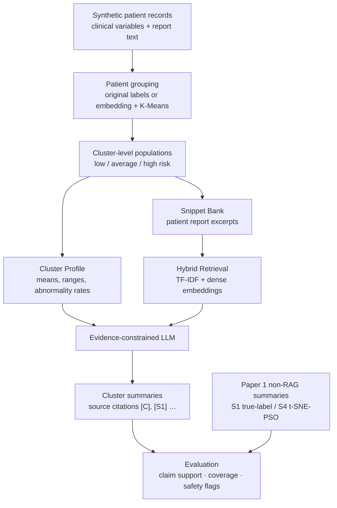

# Cluster-Aware Medical Report Summarization: Clustering + Hybrid RAG

**Research code and reproducibility notes for two peer-reviewed papers** on cluster-level medical report summarization using large language models (LLMs).

[](https://doi.org/10.1109/ACDSA65407.2025.11165844)
[](https://proceedings.mlr.press/v318/torabizadeh26a.html)
[](#reproducibility)

> **Scope:** Experimental research on **synthetic hypertension patient data**. This is *not* a clinical decision-support product; generated text is not medical advice. The repository is intended to make the methods, inputs, prompts, evaluations, and limitations inspectable.

## Overview

The project addresses two linked problems:

1. **Paper 1 — Context:** Organize patients into coherent clinical groups using nonlinear dimensionality reduction and K-Means before producing LLM summaries.
2. **Paper 2 — Faithfulness:** Add cluster profiles, retrieved patient-report snippets, hybrid lexical/semantic retrieval, and citation-constrained generation to improve the traceability of cluster-level summaries.

Both papers use a small **synthetic hypertension cohort** organized into low-, average-, and high-risk groups. The results do **not** establish clinical validity on real patient records.

## Publications

| | Paper 1 | Paper 2 |
| --- | --- | --- |
| **Title** | *Embedding-Enhanced Patient Clustering for Customized Medical Report Summarization using LLMs* | *Cluster-Aware Retrieval-Augmented Generation (RAG) with Hybrid Retrieval for Faithful Medical Report Summarization* |
| **Venue** | IEEE International Conference on Artificial Intelligence, Computer, Data Sciences and Applications (**ACDSA 2025**) | 39th Canadian Conference on Artificial Intelligence, **PMLR 318 (2026)** |
| **Publication** | pp. 1–6 | pp. 1162–1168 |
| **Read / cite** | [DOI: 10.1109/ACDSA65407.2025.11165844](https://doi.org/10.1109/ACDSA65407.2025.11165844) | [Open-access paper and BibTeX](https://proceedings.mlr.press/v318/torabizadeh26a.html) |

**Authors (both papers):** Kiarash Torabizadeh · Rachid Hedjam · Mebarka Allaoui · Bessam Abdulrazak.

**Affiliations reported in the publications:** Department of Computer Science, **Bishop's University**, Sherbrooke, Québec, Canada (Torabizadeh, Hedjam, Allaoui); Department of Computer Science, **Université de Sherbrooke**, Sherbrooke, Québec, Canada (Abdulrazak). Paper 2 additionally notes the **Université du Québec en Outaouais (UQO)** affiliation for Rachid Hedjam. All four authors are credited for both research works; individual contribution roles are not assigned here because they have not been independently verified.

## Paper 2 — Research pipeline and diagram

**Editable schematic of the published Paper 2 architecture** (adapted from Figure 1; not a pixel-for-pixel reproduction of the printed figure):



The **original Figure 1** is available in the [published Paper 2 PDF](https://raw.githubusercontent.com/mlresearch/v318/main/assets/torabizadeh26a/torabizadeh26a.pdf). To display the **exact published image** in this README, export it from the paper as `docs/images/paper2-figure1.png`, commit that image, and replace this schematic with ``; retain the source citation in the caption.

### Retrieval and generation

The retriever scores candidate evidence with

$$
 s_{\mathrm{hybrid}}(q,d) = \alpha\,\widehat{s}_{\mathrm{TF-IDF}}(q,d) + (1-\alpha)\,\widehat{s}_{\mathrm{embedding}}(q,d).
$$

- **α = 0:** embedding-only retrieval; **α = 1:** TF-IDF-only retrieval.
- The experimental sweep uses **α ∈ {0, 0.25, 0.5, 0.75, 1}** and **top-k = 8** in the available notebook.
- A structured cluster profile is supplied separately; the LLM is instructed to cite the profile (`[C]`) or retrieved snippets (`[S1]`, etc.) and acknowledge missing evidence.

## Repository layout

The research files are currently stored under a nested project directory. Use the links below to find the actual source code:

```text
llm-medical-summarization-clustering-rag/     # GitHub repository root
├── README.md                                  # This research homepage
├── CITATION.cff
├── CITATIONS.bib
├── requirements.txt
├── docs/                                      # Reproducibility and provenance
└── llm-medical-summarization-clustering-rag/  # Existing project directory
    ├── 1-clustering-llm-baseline/
    │   ├── Clustering_evaluation.py
    │   ├── UMAP.py
    │   ├── t-SNE.py
    │   ├── t-SNE-PSO.py
    │   ├── patient_dataset_with_reports_2.csv
    │   └── Results on Hypertension Dataset/
    └── 2-cluster-aware-rag/
        ├── Data/
        ├── RAG_for_second_paper_2_alpha_sweep.ipynb   # Original notebook
        └── Paper2_Cluster_Aware_Hybrid_RAG_Reproducibility.ipynb # Clean documented notebook
```

- **[Paper 1 source code and outputs](llm-medical-summarization-clustering-rag/1-clustering-llm-baseline/)** — t-SNE, UMAP, t-SNE-PSO, clustering metrics, synthetic data and saved results.
- **[Paper 2 code and data](llm-medical-summarization-clustering-rag/2-cluster-aware-rag/)** — cluster-aware hybrid RAG notebook and input data directory.
- **[Clean Paper 2 reproducibility notebook](llm-medical-summarization-clustering-rag/2-cluster-aware-rag/Paper2_Cluster_Aware_Hybrid_RAG_Reproducibility.ipynb)** — add this notebook to that directory before relying on this link.

These paths retain the current nested layout rather than restructuring published code. The names under `Data/` and `Results on Hypertension Dataset/` should be checked against the actual published files before declaring the repository fully reproducible.

## Reproducibility

**Start here:** [Step-by-step reproduction guide](docs/REPRODUCIBILITY.md) · [Input files and dataset provenance](docs/DATA_AND_INPUTS.md) · [Published results vs. reruns](docs/RESULTS_AND_LIMITATIONS.md).

### Quick start

```bash
git clone https://github.com/Kiarash-T/llm-medical-summarization-clustering-rag.git
cd llm-medical-summarization-clustering-rag
python -m venv .venv
# macOS/Linux:
source .venv/bin/activate
# Windows PowerShell: .venv\Scripts\Activate.ps1
python -m pip install -r requirements.txt
jupyter lab
```

For **Paper 1**, work from `llm-medical-summarization-clustering-rag/1-clustering-llm-baseline/` and use the provided Python scripts (`t-SNE.py`, `UMAP.py`, `t-SNE-PSO.py`, and `Clustering_evaluation.py`), reviewing their expected input/output paths before running. The scripts have not yet been validated as a single clean-environment workflow.

For **Paper 2**, open `llm-medical-summarization-clustering-rag/2-cluster-aware-rag/Paper2_Cluster_Aware_Hybrid_RAG_Reproducibility.ipynb` (after uploading that file). Its input files must be available at the expected Colab/Jupyter working directory; inspect `2-cluster-aware-rag/Data/` and use the [reproduction guide](docs/REPRODUCIBILITY.md). Do not run notebook-exported `.py` files containing notebook magics as ordinary Python scripts without adjusting them.

**OpenAI access for Paper 2:** Configure `OPENAI_API_KEY` via an environment variable or Colab Secrets. Never put an API key in a notebook, committed file, screenshot, or Git history. **API generation incurs usage costs.**

### Paper-specific reproducibility paths

| Paper | Inputs | Main outputs | Evaluation |
| --- | --- | --- | --- |
| Paper 1 | Synthetic patient dataset, group labels and clinical reports | 3-dimensional/2-dimensional embedding-based clusters, S1/S2/S3/S4 cluster summaries | Cluster quality and similarity of embedding-derived summaries to true-label reference S1 |
| Paper 2 | `cluster_profile_docs.md`, `snippet_bank_reports.jsonl`, `cluster_profile_table.csv`, `step7_eval_input_template.json`, original S1/S4 summary workbooks | `alpha_sweep_results.csv`, `alpha_sweep_macro.csv`, `alpha_sweep_outputs.json`, S1/S4-reference JSON inputs | Supported-claim rate, indicator coverage, rule-based safety flags, baseline-to-RAG deltas |

The available Python/Colab implementation of Paper 2 uses the `gpt-4o-mini` model identifier and `all-MiniLM-L6-v2` embedding model. An OpenAI alias and an external hosted API may not produce byte-identical generations across dates or repeated requests, even at `temperature=0`.

## Published results (not guaranteed reproduction targets)

The **published** Paper 2 reports the following *macro averages* under its evaluation protocol:

| Condition | Supported-claim rate | Required-indicator completeness |
| --- | ---: | ---: |
| S1: original risk-label grouping, no RAG | 11.1% | 83.3% |
| S4: t-SNE-PSO grouping, no RAG | 8.3% | 83.3% |
| Retrieval-grounded summary | 33.3% | 100.0% |

The paper reports **α = 0.25** as the selected weight. Independent notebook reruns may yield different optimal α and faithfulness scores because generation and lexical thresholding vary. These figures are *published results*, not validation that the current checkout produces them exactly. For experiment-level details and caveats, see [Results and limitations](docs/RESULTS_AND_LIMITATIONS.md).

## Reproducibility and research cautions

The evaluator uses TF-IDF similarity and a threshold-based decision to label claims as “supported.” This is a **lexical proxy**, not a clinical entailment judgment. Normalized/renamed numerical statements can receive low scores even when supported by the cluster profile. The code also uses rule-based keyword coverage and safety flags. Reruns must log model identifier, prompt, generation parameters, α, top-k, evidence IDs, evaluator version, and dependency versions.

The available local snippet bank previously audited for Paper 2 contains **149 snippet records** (35 low, 62 average, 52 high) and **three profile documents**. This differs from the paper's approximate 150-patient description and an older code comment expecting 150 snippets. Report actual released-file counts rather than silently changing them. The shared RAG summary/evidence evaluated against S1 and S4 references in the inspected notebook should **not** be characterized as two independently generated RAG pipelines.

## How to cite

If you use the clustering methodology, cite **Paper 1**. If you use the evidence-grounding/retrieval methodology, cite **Paper 2**. For use of both parts, cite both publications. Copyable BibTeX entries are provided in [`CITATIONS.bib`](CITATIONS.bib), and GitHub citation metadata is in [`CITATION.cff`](CITATION.cff).

## Security, license, and contact

- **Security:** see [`SECURITY.md`](SECURITY.md). Revoke any previously committed OpenAI keys and remove exposed credentials from repository history before public release.
- **License:** choose and commit a license approved by all applicable rights holders; this package does not presume one. Without a license, others may read the public code but do not automatically receive permission to reuse or redistribute it.
- **Research correspondence:** Kiarash Torabizadeh, corresponding author; contact information is available in the linked publications.

**Acknowledgment:** This repository accompanies collaborative research authored by Kiarash Torabizadeh, Rachid Hedjam, Mebarka Allaoui, and Bessam Abdulrazak, with the institutional affiliations stated above.
